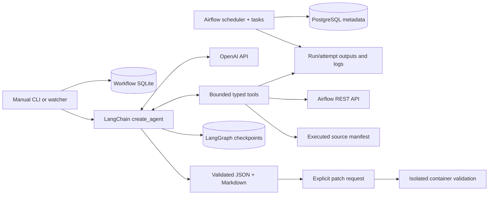

# Architecture and boundaries

The model chooses evidence to inspect and interprets it. LangChain supplies the
agent loop, typed tool integration, middleware and structured response handling.
LangGraph executes that loop and persists messages/checkpoints. Deterministic
Python retrieves data, enforces capabilities, measures facts and checks schemas.
No Codex API/CLI/SDK runs inside the investigator.

`cli.py:investigate` creates a new UUID and thread. `runner.py` is the killable
process boundary; `agent.py:run_agent` opens a persistent SqliteSaver and calls
`create_agent` with a provider-native Pydantic response strategy. Tool calls are
selected by the model, not by scenario labels. Middleware limits model/tool calls;
callbacks record usage and reject excessive context/time. Provider retries are
bounded. A failure keeps evidence/checkpoints and an incomplete operation record.

The provider route is Responses (`use_responses_api=True`, `store=False`);
LangGraph owns local conversation persistence. `FollowupContext` bounds older
turns within the same investigation only. A fresh thread cannot inherit another
diagnosis. `EvidenceContext` clears older tool outputs in a request copy, retaining
up to four recent source ranges / 24 KB and two successful distinct attempt logs /
16 KB. Later source navigation must not erase the immediate exception. This context
editing never deletes stored evidence or checkpoints.
`FinalizeWithinBudget` removes tools when retrieval is exhausted or the final
two slots are reached (with at least six allowed calls; short operations reserve
one final output slot). Strict ProviderStrategy
still requests structured output. Application integrity checks can request one
correction using existing evidence; the rejected candidate remains saved, retrieval
stays closed, and total call/time/spend limits do not reset. A second rejection
or an unresolved native output parsing error preserves an incomplete outcome.
Forced report finalization additionally constrains evidence IDs to this
investigation's retrieved records and verified alignment to checked provenance.
Supported claims require available IDs; uncertain claims may reference known
missing/error records. Diagnosis/remediation text is still generated by the model.
ProviderStrategy receives a JSON schema for this final call; its returned dict is
revalidated as Diagnosis before the unchanged application checks. This is not a
semantic judge and does not guarantee that a cited record supports the claim.
`ResponsePhaseOutput` respects explicit completed Responses phase labels when
LangChain concatenation makes JSON invalid. Original commentary and final messages
remain in checkpoints. Multiple final messages must be byte-identical; final
text must independently pass schema and subsequent evidence validation. It never
accepts incomplete/conflicting outputs or rewrites evidence IDs.
Rejected batch calls receive errors and cannot execute. Structural completion
still requires report review: the live v3 report completed but misstated evidence
availability, which motivated the source-retention fix.

`watcher.py:discover` fetches real task states, selecting `failed` tasks rather
than treating `upstream_failed` or every skipped task as a root cause. Event
identity includes run, task, map index and attempt. SQLite atomically deduplicates
notifications. Manual freshness is a separate operation, so it does not undo
deduplication. An outside watcher can observe failures even when task code dies.

`airflow.py` targets one pinned REST API. Run fields and task definitions are
projected to exclude `conf`/executor controls. Log selectors include exact
attempt and map index; continuation tokens/page and byte caps are explicit.
Current API state is labeled current. It is not silently substituted for the
code or destination state at execution.
GET transport failures receive one retry after250ms; each request has a10s socket
timeout, bounded response bytes and bounded auth refresh. Mutations are never
automatically retried. Verification records incomplete retrievals and checks
saved artifacts independently, rather than losing the whole result on timeout.

`evidence.py` exposes eight capabilities. Source paths must appear in a verified,
bounded content manifest. Static import inspection uses AST, never imports DAGs.
Source binding must match DAG/run identity. Checkpoint and destination tools open
one run/attempt artifact only. Destination SQL statements are fixed, read-only
queries; the model cannot supply SQL or paths outside the capability. There is
no shell tool and no tool for reading credentials, private plans or prior reports.

`demo/runtime/runtime.py` is trusted execution infrastructure with private fault
controls. It invokes versioned business helpers and freezes attempt evidence.
The model sees the selected helper entry point and infrastructure hash, not the
private configuration or implementation. This is a deliberate static-analysis
boundary; unobserved infrastructure behavior must remain a limitation.

`demo.py:prepare_history` uses future schedules and supported pause/unpause API
calls. Airflow creates runs. The collector stores post-execution API evidence
separately from execution-time checkpoint/database snapshots. `verify_history`
checks persisted history without triggering runs. A fresh model investigation is
a separate gate; a successful persistence check does not imply model quality.

Patch requests reuse the investigation thread, retrieve surrounding exact source,
and produce constrained replacement edits. `patching.py` creates a separate copy
and unified diff. Prepared container tests run with fixed dependencies, no
network/secrets, read-only mounts and resource limits. Validation never modifies
deployed DAGs or source snapshots. Automatic recovery is excluded.
Each validation invocation keeps a separate UUID/log/result. Latest summaries
do not erase earlier attempts. The Windows wrapper temporarily stops project
services during build/validation to free memory, then restores and checks history.
The actual patch passed five checks in validation843aea7e. DAG parsing uses a bare
Python subprocess inside the same restricted container, with unchanged assertions.
Earlier stalls/crash are retained; the exact native crash cause is unconfirmed.

Known limits: SQLite serializes writers; locks serialize only one investigation.
Polling can miss intermediate transitions. Abrupt death can prevent task-exit
capture. Source search is bounded and cannot resolve arbitrary dynamic dispatch.
Evidence-ID integrity is a structural check, not a semantic proof. This version
does not guarantee exactly-once agent/provider execution.
