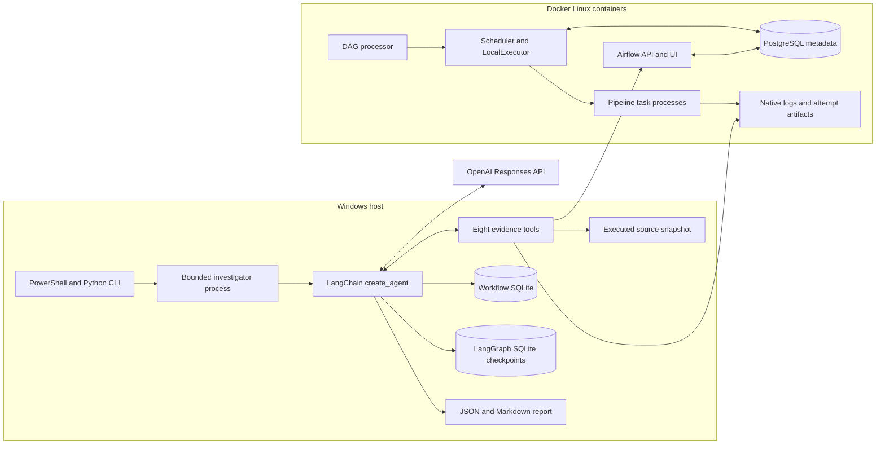

# Airflow Investigation Workflow Demo and Code Handbook

This project investigates an existing Airflow run using an OpenAI model, bounded evidence tools, and persistent conversation state. The model chooses what to inspect. Python retrieves evidence and enforces limits. A requested patch is copied into an isolated workspace and tested separately; deployed pipelines are never repaired automatically.

The local workflow has passed its execution gates. That means real scheduled runs, fresh live investigations, resumed conversations, watcher launch and deduplication, restart persistence, and an isolated patch validation were exercised. It does not mean every model recommendation is correct. The latest small evaluation had 12 accepted reports, but evidence coverage and recovery advice varied. The model still needs engineering review.

Study this in order. First understand the incident, then the commands, then trace one request, and finally study the controls around it. Containers can remain stopped while reading. Commands below are instructions for rehearsal or demo day, not a request to start services now.

The examples below use the verified Windows installation. For Bash command equivalents, fresh Linux setup, container user ownership and the distinction between native Linux, WSL and Git Bash, see [Linux terminal runbook](linux-terminal.md). Native Linux end-to-end behavior still needs verification before using that route in an interview.

## 1 The problem this project addresses

When an unfamiliar pipeline fails, an engineer usually opens Airflow, identifies the failed task and attempt, reads logs, locates the executed helper code, inspects destination data, checks retries, and decides whether a rerun is safe. The exception alone may explain why execution stopped without explaining what data was already changed.

The primary example deliberately exposes that distinction. A paginated fetch raises ConnectionError at page 2. However, pages 0 and 1 were already committed, and the resume checkpoint still says 0. The automatic retry starts again at page 0 and appends the same events again. Fixing connectivity alone would not reconcile the duplicated historical destination.

The investigator is intended to connect those pieces of evidence and describe remediation with its assumptions. The important output is a reviewable explanation of failure, write effects, uncertainty, and verification steps.

An accurate project introduction is:

> I built a local Airflow investigation prototype using LangChain and LangGraph. It retrieves exact attempt logs, execution-bound source, checkpoint evidence and destination statistics through restricted tools. The model chooses its investigation path, while Python controls identity, access, time, cost and report integrity. Requested patches are isolated and validated separately.

The pipelines use synthetic inputs and controlled faults, but they actually ran through Airflow's scheduler and task execution. They are not production incidents. Describe AI assistance honestly: Codex helped develop and debug the application; the runtime investigator calls the OpenAI API through LangChain.

## 2 Terms you need before reading the code

| Term | Meaning in this project |
|---|---|
| DAG | Directed acyclic graph: a pipeline definition with tasks and dependencies, without dependency cycles |
| DAG run | One scheduled or manual execution of that DAG |
| Task | A named step such as ingest or publish |
| Task instance | A task associated with a particular run and mapping identity |
| Attempt or try number | An execution attempt of the task instance; an automatic retry creates another attempt |
| map_index | Identity of a mapped task child; -1 is the ordinary non-mapped identity used in this demo |
| failed | This task executed and failed |
| upstream_failed | An upstream failure prevented this task from running successfully under its dependency rule |
| skipped | A separate Airflow state, often resulting from branching or trigger behavior; not interchangeable with upstream_failed |
| trigger rule | The condition under which downstream work is allowed to run |
| checkpoint | Application progress marker indicating the next page to read |
| commit | Make the current database transaction durable |
| rollback | Undo uncommitted work in the current transaction; it cannot undo earlier commits |
| idempotency | Repeating an operation has the same intended final effect as executing it once |
| snapshot | A saved copy of source or destination state associated with an execution or attempt |
| provenance | Where a piece of evidence came from, its selector, collection time and availability |
| tool | A Python capability exposed to the model, such as reading one attempt's logs |
| agent | The loop in which the model chooses tools, reads results and produces an answer |
| investigation ID | UUID identifying one investigation in workflow.sqlite |
| thread ID | UUID used by LangGraph to persist that investigation's conversation state |
| operation ID | UUID identifying a report, patch, failure, or normalization record within an investigation |
| evidence ID | Identifier such as ev_..., created for one retrieval within one investigation |
| middleware | Code that wraps a model call to enforce limits or adjust the request |
| structured output | A report constrained to a schema, rather than arbitrary prose |
| admission | Checking and reserving sufficient local budget before dispatching an operation |

There are two kinds of checkpoint. The pipeline checkpoint is the page number in its output database. LangGraph checkpoints save agent messages and graph state. These are unrelated kinds of progress and live in different storage.

## 3 The two workflows and where they run

Airflow executes pipelines. The investigator diagnoses their recorded executions. Diagnosing a run does not execute the pipeline again.



The workflow is local, but model inference is remote. Selected retrieved evidence is transmitted to OpenAI. store=False disables provider-side Responses state storage for these requests; it does not make inference local or mean no data is transmitted. LangGraph owns the application's local conversation persistence.

| Component | Responsibility |
|---|---|
| PostgreSQL 16.10 | Airflow execution metadata, including run/task state |
| Airflow API and UI | Browser interface and authenticated REST endpoints |
| Scheduler with LocalExecutor | Decide which work can run and launch local task processes |
| DAG processor | Parse the deployed DAG definitions |
| Host Python application | CLI, API adapter, evidence retrieval, agent, reports and evaluation |
| OpenAI model | Choose tool calls and interpret returned evidence |

LocalExecutor avoids a separate Celery worker fleet and Redis broker. In compose.yaml, total task parallelism is 2, maximum active tasks per DAG is 2, and each DAG permits one active run. API workers and parsing processes are each limited to one. These are practical choices for this 8 GB Windows machine, not production capacity recommendations.

The API binds to 127.0.0.1:8080. Containers use service names such as postgres:5432 and api:8080. localhost inside a container means that container, not the Windows host or another service.

## 4 Demo day commands and what they mean

### 4.1 Open the correct folder and Python

Open regular Windows PowerShell outside Codex. Open Docker Desktop and wait for its Linux engine to become available. Then:

```powershell
cd 'C:\Users\mayank\Documents\Codex\2026-10-12\github-plugin-github-openai-curated-remote\outputs\airflow-investigation-workflow'
```

The working directory matters because Settings.load reads this project's .env and state directory. The CLI also checks that pyproject.toml exists here.

Every command below uses .\.venv\Scripts\python.exe. That selects this project's installed dependencies explicitly. Activating the virtual environment is unnecessary when using its Python executable directly. In python -m afi.cli, -m means run the installed Python module afi.cli as the entry point.

### 4.2 Start the existing services

```powershell
powershell -NoProfile -ExecutionPolicy Bypass -File .\scripts\airflow.ps1 -Action Start
```

| Part | Purpose |
|---|---|
| powershell | Launch a separate PowerShell process |
| -NoProfile | Avoid loading personal startup/profile scripts into that process |
| -ExecutionPolicy Bypass | Permit this script in that process; this does not permanently change machine policy |
| -File | Execute the named script |
| -Action Start | Select the script's startup branch |

The script locates Docker in either the user or system installation, adds its directory to this process's PATH, checks a Linux engine and memory, validates Compose, pulls the pinned images, starts PostgreSQL, performs metadata migration and starts the Airflow services. It checks service health and DAG imports. Existing deployment setup is reused.

On this machine the script requires at least 2 GB available Windows memory and at least 3.5 GiB engine memory, described operationally as roughly 4 GB allocated to Docker. It does not close applications or change firmware. Startup can take minutes. An initialization container exits after its job; it is not a required continuously running service.

Startup preserves existing runs and keeps DAGs paused. Do not run PrepareHistory again: the ten prepared scheduled runs already exist. Do not click trigger, clear, retry, or unpause in the Airflow UI during the investigation demo.

### 4.3 Check the installation and preserved execution history

```powershell
powershell -NoProfile -ExecutionPolicy Bypass -File .\scripts\airflow.ps1 -Action Status
.\.venv\Scripts\python.exe -m afi.cli demo verify-history
.\.venv\Scripts\python.exe -m afi.cli doctor --model
```

Status shows Compose state and checks PostgreSQL, scheduler, DAG processor and imports through the API. Expect status pass, no import errors, and all three DAGs paused. No triggerer is required by these DAGs.

verify-history reads the recorded scheduled inventory, compares it with current Airflow metadata, checks run/attempt logs and artifact hashes, checks counts 3/3/4 and pause states, then saves a new verification JSON. It proves preserved access, not model reasoning.

doctor prints installed Python/framework versions, whether a key is configured, Docker/API health, and a tiny OpenAI response when --model is included. It does not print the key. A successful smoke response proves basic connectivity; the real investigator's tool/schema path is a separate check. Doctor smoke calls are currently outside the agent ledger.

Open http://localhost:8080 and use synthetic local credentials airflow / airflow. Select local_pipeline_03 and the existing failed run. These credentials and loopback binding are for the local demo.

In the Airflow 3.3.1 interface, select Dags in the main navigation. The list should
contain local_pipeline_01 (profiling), local_pipeline_02 (enrichment) and
local_pipeline_03 (ingestion). Click local_pipeline_03 to open its details.
Graph shows the dependency structure; Runs lists actual executions; Grid shows
task states across runs. Select the primary run in Runs, open its Graph view,
then select ingest to inspect its task instance and Logs. The primary run's
ingest failed, publish is upstream_failed and reconcile succeeded. Keep the DAGs
paused and inspect existing runs without triggering or clearing them.
See the [pinned Airflow UI guide](https://airflow.apache.org/docs/apache-airflow/3.3.1/ui.html).

### 4.4 Start a fresh investigation of the primary failure

```powershell
$primaryRun = 'scheduled__2026-10-12T20:11:06.529124+00:00'
.\.venv\Scripts\python.exe -m afi.cli investigate local_pipeline_03 $primaryRun --task ingest --attempt 2 --fresh --bounded
```

| Argument | Meaning |
|---|---|
| investigate | Create and execute a new investigation |
| local_pipeline_03 | DAG identity, not a scenario label supplied to the model |
| $primaryRun | Exact scheduler-created run ID; retain its full timezone suffix |
| --task ingest | Focus on the actual failed processing task |
| --attempt 2 | Select its second recorded attempt |
| --fresh | Communicate that this is a new investigation |
| --bounded | Use at most five model calls, 24 tools, 100 KB context admission and 3000 output tokens, respecting lower configured limits |

The default map_index is -1. One configured retry produced attempts 1 and 2: retries=1 means one retry after the initial attempt, not one total attempt.

Current implementation detail: investigate always calls Store.create without an event key. Freshness is unconditional; --fresh is an explicit intent flag, not a cache switch. There is no cached-diagnosis branch, even if the same run is selected repeatedly.

Expect output resembling:

```text
New investigation <new UUID>
model call 1/5
tool overview -> ev_... [available; truncated=False]
...
finalization: retrieval closed; requesting structured result
Saved operation <operation UUID>: <folder>
```

The tool sequence can differ. The model chooses it. A successful report can still omit relevant evidence or contain a weak inference, so inspect the saved text. If it prints Incomplete, retain the failure; do not describe it as a diagnosis.

### 4.5 Read the report and ask a follow-up

Copy the actual investigation UUID printed by your new invocation:

```powershell
$investigationId = '<new investigation UUID>'
.\.venv\Scripts\python.exe -m afi.cli show $investigationId
.\.venv\Scripts\python.exe -m afi.cli ask $investigationId 'Explain the exact exception, the commit and checkpoint ordering, and the observed destination duplicates. Inspect both attempts and the relevant source. Separate observations from hypotheses and state recovery preconditions.'
.\.venv\Scripts\python.exe -m afi.cli show $investigationId
```

show reads the latest saved report and does not call the model. It labels the result SAVED REPORT. ask makes a new model operation in the same LangGraph thread, appending messages and evidence rather than starting from a different investigation.

ask and continue use the normal configured limits, not the earlier command's --bounded flag. Here those normal limits are eight calls, 120 KB context and 4000 output tokens. process.py explicitly forwards each invocation's admitted settings to its child.

The printed folder contains result.json, report.md and evidence.json. result.json has the structured diagnosis and runtime metadata; evidence.json has the retrieved records; report.md is the readable rendering. Existing operations are preserved under their own UUID folders.

### 4.6 Show a counterexample

```powershell
.\.venv\Scripts\python.exe -m afi.cli investigate local_pipeline_03 'scheduled__2026-10-12T20:12:06.529124+00:00' --task ingest --attempt 2 --fresh --bounded
```

This is the rollback contrast. Its fetch also fails at page 2, but its source wraps the whole loop in one transaction. Frozen output remains zero rows and checkpoint 0. A good report should explain that different write outcome and avoid recommending the same fix automatically.

If you have time, inspect the insufficient-evidence run:

```powershell
.\.venv\Scripts\python.exe -m afi.cli investigate local_pipeline_03 'scheduled__2026-10-12T20:13:06.529124+00:00' --task ingest --attempt 2 --fresh --bounded
```

Its immediate exception is visible, while source binding and attempt state artifacts are withheld from the capability. A credible answer preserves unknown alignment and unresolved write effects. Missing evidence is not proof of zero writes.

### 4.7 Explain watcher behavior without clearing its state

```powershell
.\.venv\Scripts\python.exe -m afi.cli watch --once --bounded
```

The verified watcher already recorded the six prepared failures. A scan now should find no new events and make no investigator calls for those unchanged attempts. That is correct deduplication, not a broken demo. Show the saved watcher verification if you need evidence of its earlier six live launches.

watch without --once polls continuously; Ctrl+C stops that terminal process. A new failure identity can create a new investigation. Manual investigate remains fresh even when watcher deduplication has seen the same attempt.

Do not delete events to make an old failure appear new during an interview. The genuine launch and second-process dedup result are recorded in state/verifications/watcher-67c603a7-e620-45ad-831d-7fe8bba0c407.json.

### 4.8 Show a requested patch and its validation

For a new patch request:

```powershell
.\.venv\Scripts\python.exe -m afi.cli propose-fix $investigationId 'Propose the smallest change to append_pages that atomically commits each page and its next-page checkpoint. Retrieve the exact executed source, preserve other helpers, and state stable-pagination, single-writer and historical-reconciliation preconditions.'
```

This makes a model call and generates a proposal on the same investigation thread. It creates a separate copied source workspace and proposed.diff. It does not edit deployment or restart a DAG.

The existing live-generated patch and completed validation can be inspected without another model call:

```powershell
$recordedPatch = '.\state\investigations\90ca084f-7961-41b7-863d-80f120758840\e565fab8-3faf-44e0-b39a-2083cd3aa205'
Get-Content "$recordedPatch\proposed.diff"
Get-Content "$recordedPatch\validations\843aea7e-223f-40ce-9726-a7196c34c951\result.json"
```

Label these as the previously generated and locally validated artifact. The five-check validation passed in 18.281 seconds. It is not a new validation performed by reading the file.

To validate a newly generated patch, copy its printed operation ID and run validate-fix. This executes the copied code in a prepared Docker image, so rehearse it beforehand. On this memory-constrained machine the verified wrapper temporarily stops Airflow services for validation and restores them afterward. That longer wrapper is for rehearsal, not necessary for the short live explanation. See README and scripts/verify-demo.ps1 for the exact existing-patch wrapper.

### 4.9 End the demonstration

```powershell
powershell -NoProfile -ExecutionPolicy Bypass -File .\scripts\airflow.ps1 -Action Stop
```

This stops project containers and preserves metadata, logs and artifacts. Stop any continuous watcher with Ctrl+C. Docker Desktop can be quit if other work does not need it. Do not use down -v, rerun history preparation, or reset state as part of the normal demo.

### 4.10 Task logs terminal progress evidence and reports

These are different things. Understanding their relationship is essential when demonstrating the project.

| What you see | Who produces it | What it tells you | Where to view it |
|---|---|---|---|
| Pipeline task log | Airflow task process and business/runtime logging | What happened during a particular task attempt, including commits and traceback | Airflow task Logs view, native logs directory, or retrieved log evidence |
| Investigator terminal progress | CLI, runner, agent callbacks and evidence wrapper | Which investigation/model/tool operation is running and where artifacts were saved | The PowerShell window running investigate, ask or watch |
| Container service logs | API, scheduler, DAG processor and PostgreSQL processes | Service startup, parsing, scheduling and infrastructure problems | Docker Compose logs |
| Evidence record | EvidenceTools.capture | Retrieved content plus ID, exact selector, availability and collection time | workflow.sqlite and a successful report's evidence.json |
| Diagnostic report | Model output after application validation | Explanation of failure, findings, uncertainty, write effects and remediation | result.json and report.md; show displays the latest saved report |
| Patch validation log | Trusted validation runner and pytest inside Docker | Which behavior checks actually executed and their outcome | The validation UUID folder's validation.log |

The task log already existed before an investigation started. Investigating does not regenerate it by rerunning the task. The terminal progress appears now because a new investigation is retrieving and interpreting that earlier execution.

An evidence ID is the bridge. A tool wraps retrieved task log content as a record such as ev_18f4..., the model cites that ID in a claim, and the report's evidence provenance section identifies the record. You can inspect the same ID in evidence.json to see the exact text the model was given.

```text
Earlier pipeline attempt
  -> native task log and frozen destination/checkpoint
  -> current investigation retrieves selected evidence
  -> EvidenceTools assigns evidence IDs and records provenance
  -> model generates claims citing those IDs
  -> application validates report structure/references/alignment
  -> result.json stores the report
  -> reporting.py renders report.md
```

The report does not simply copy every task log line. It combines different evidence types into an explanation. For example, the log supports ConnectionError at page 2; source supports commit/checkpoint ordering; destination statistics support repeated tuples; checkpoint evidence supports progress remaining at 0. Each claim still needs review against its cited records.

### 4.11 Interpret every important terminal message

| Terminal message | Exact meaning | What it does not prove |
|---|---|---|
| New investigation UUID | Store.create allocated a new investigation and thread | The Airflow task was rerun |
| model call 1/5 | First logical model dispatch out of this invocation's cap | It is not the pipeline's attempt number or a tool count; the SDK may retry HTTP internally |
| tool overview -> ev_... | Run overview retrieval returned a saved evidence record | The model has found the root cause |
| tool logs -> ev_... | Exact selected attempt logs were retrieved or their retrieval result recorded | The whole run's logs were inspected |
| tool source -> ev_... | A source search/read result was captured | Every helper or the entire file was read; inspect the selector |
| tool checkpoint -> ev_... | One attempt's frozen progress retrieval was recorded | A checkpoint was advanced or modified by the investigator |
| tool destination -> ev_... | Fixed read-only statistics were retrieved | Arbitrary diagnostic SQL or a repair ran |
| available | The retrieval returned data | The model's interpretation of that data is correct |
| missing | The required artifact was absent | The pipeline did not perform writes |
| error | Retrieval/request failed | The underlying artifact necessarily does not exist |
| truncated=True | Returned evidence has a scope/size limit | The omitted content is irrelevant |
| finalization: retrieval closed | Tools are removed for the remaining structured answer | The application has already accepted a report |
| provider output: explicit completed final phase parsed | Phase-aware normalization parsed completed final text and retained originals | Evidence references or report meaning have already passed review |
| report validation: one bounded correction | A rejected candidate is saved; one correction uses existing evidence | A new unlimited investigation budget was granted |
| Saved operation UUID: folder | A successful report or generated patch operation returned | A patch was deployed; inspect the operation's files/status |
| Incomplete: error type | The operation did not produce an accepted result | A diagnosis should be inferred from rejected provider text |
| Failure details: path | Location of the preserved failure result | It is an accepted report |
| watcher new investigation UUID | A previously unseen event identity was registered | Every polling scan creates a fresh investigation |

The progress display shows tool activity and public status, not a private chain-of-thought transcript. Tool names in the terminal use evidence categories: source_search and source_read both print tool source. Their provenance selectors and data distinguish search from numbered reads.

Progress lines are not automatically saved as a standalone terminal transcript. Structured records and checkpoints are saved. If you want a transcript when rehearsing, choose a new filename and pipe the live command through Tee-Object:

```powershell
New-Item -ItemType Directory -Path .\work -Force | Out-Null
$terminalLog = Join-Path .\work ('demo-terminal-' + [guid]::NewGuid().ToString() + '.txt')
.\.venv\Scripts\python.exe -m afi.cli investigate local_pipeline_03 $primaryRun --task ingest --attempt 2 --fresh --bounded 2>&1 | Tee-Object -FilePath $terminalLog
```

This is a real additional model operation, so use it instead of the ordinary investigate command when you want capture, not as an extra duplicate step. 2>&1 combines standard error with standard output; Tee-Object both displays and writes that stream. It does not convert an incomplete result into success.

### 4.12 Understand the report fields

result.json for an accepted report has five major parts: investigation_id, identity, created_at, diagnosis and runtime. identity identifies what was investigated, diagnosis contains the answer, and runtime records how it was produced. report.md renders those same conclusions for reading.

| Diagnosis field | Question it answers |
|---|---|
| source_alignment | Can inspected source be connected to this execution, or is it approximate/unknown? |
| task_purpose | What does the selected task appear intended to do? |
| observed_failure | Which failure and exact attempt are established? |
| confirmed_findings | Which material facts are supported by available evidence? |
| hypotheses | What explanations remain plausible or unresolved? |
| missing_or_conflicting_evidence | Which important questions cannot be settled and why? |
| downstream_effects | What happened to dependent tasks or data flow? |
| data_write_retry_assessment | Were writes committed, duplicated, rolled back or left uncertain, and is replay risky? |
| remediation_options | What change or investigation is proposed, with preconditions and verification steps? |
| limitations | What prevents broader conclusions? |

A claim includes text, support and evidence_ids. support is supported, plausible or unresolved; it is not a numeric confidence score. Missing-evidence and limitation entries are plain explanatory strings. Remediation options have a proposal, evidence IDs, preconditions and verification_steps.

The Markdown report adds an Evidence provenance section with each record's ID, kind, availability, truncation, selector/source revision and collection time. It also includes Runtime metadata. That metadata records model, prompt/framework versions, limits, model/tool counts, input/output tokens, estimated cost, elapsed time, retrieval coverage and thread ID. A historical report's recorded approved total can differ from today's configuration; it describes that operation's settings.

result.json is a generic operation filename. A failure result, patch proposal or validation result has a different payload than an accepted report. Do not assume every result.json in every UUID folder is a diagnosis. workflow.sqlite records each operation's kind and status; show deliberately selects the latest accepted report operation.

### 4.13 Know the generated file structure

```text
project root/
  logs/                                  native Airflow logs
    dag_id=.../run_id=.../task_id=.../     exact task attempt log files
  deployment/                            currently deployed immutable business source
    manifest.json
    schedule.json
    passwords.json
    dags/pipelines.py
    source/...
  state/
    history.json                         inventory of actual completed scheduled runs
    workflow.sqlite                      application records and budget
    checkpoints.sqlite                   LangGraph state and messages
    snapshots/<source revision>/
      manifest.json
      source/...
    runs/<run key>/
      binding.json                       recorded execution identity/source receipt
      output.sqlite                      run destination database
      input.jsonl                        profiling input where relevant
      records.json and reference.json    enrichment/auxiliary inputs
      reconciliation.json                reconciliation task's recorded result
      published.json                     successful publish marker, when present
      attempts/<task>.<map>.<attempt>/
        checkpoint.json                  frozen attempt progress evidence
        output.sqlite                    frozen attempt destination copy
      collections/<collection UUID>/
        capture.json                     post-execution API collection and hashes
        log-<selector hash>.json           collected API log records
    investigations/<investigation UUID>/
      <report operation UUID>/
        result.json                      accepted structured report and runtime
        report.md                        readable report with provenance
        evidence.json                    evidence visible to that investigation
      <failure or repair UUID>/
        result.json                      incomplete failure or rejected candidate
      <provider normalization UUID>/
        result.json                      public phase metadata and parsed final text
      <patch operation UUID>/
        result.json                      PatchProposal and generation metadata
        proposed.diff                    isolated source change
        source/...                       copied and modified workspace
        validation.json                  latest validation summary
        validations/<validation UUID>/
          result.json                    one retained validation attempt
          validation.log                 its actual runner/test output
      <validation record UUID>/
        result.json                      application validation operation record
    evaluations/<evaluation UUID>/
      results.json                       suite plan, outcomes and runtime records
      pytest.log                         offline suite output, when applicable
      accounting-<UUID>.json              later operator accounting/integrity review
      review-notes.json                   qualitative development review, when added
    verifications/                       history, watcher and budget approval audits
    infrastructure/                      archived trusted runtime with capture metadata
    doctor.json                          latest smoke/environment diagnostic summary
  private/                               operator fault plan and case allocation
  work/                                  optional transcripts and reset archives
```

The run key is derived from a hash of DAG ID plus a separator plus run ID. It gives a safe directory name without embedding run-ID punctuation. The investigation UUID is separate because several fresh investigations can inspect the same run directory. For the primary run the recorded run key is 13ac4a6b8e7f062266ca14e531c9760b.

Some artifacts are intentionally absent for a failed or withheld-evidence case. publish did not execute successfully in the primary failed run, so do not expect its success marker. A failed operation need not have report.md/evidence.json exports, although its already-retrieved evidence remains in workflow.sqlite and messages remain in checkpoints.

### 4.14 View a real saved report and its retrieved task log offline

These commands need only the local files and Python environment; containers can remain stopped. This example uses one existing accepted primary report. For a new demo report, use the investigation and operation UUIDs printed by that invocation instead.

```powershell
$savedInv = 'c8a38c31-6b8b-4b74-9b72-8c9d21275038'
$savedOp = 'd677870b-4dd9-457f-8ed4-727658b1ccda'
$artifactDir = Join-Path .\state\investigations "$savedInv\$savedOp"

Get-ChildItem -LiteralPath $artifactDir
.\.venv\Scripts\python.exe -m afi.cli show $savedInv
Get-Content -LiteralPath "$artifactDir\report.md"

$savedReport = Get-Content -LiteralPath "$artifactDir\result.json" -Raw | ConvertFrom-Json
$evidence = Get-Content -LiteralPath "$artifactDir\evidence.json" -Raw | ConvertFrom-Json
$savedReport.identity | Format-List
$savedReport.diagnosis.observed_failure | Format-List
$savedReport.runtime | ConvertTo-Json -Depth 12

$logRecords = $evidence | Where-Object { $_.kind -eq 'logs' }
$logRecords | Select-Object id, availability, truncated,
    @{Name='task'; Expression={$_.provenance.selector.task_id}},
    @{Name='attempt'; Expression={$_.provenance.selector.attempt}},
    @{Name='map'; Expression={$_.provenance.selector.map_index}}
$logRecords | ForEach-Object { $_.data.text }
```

Get-Content -Raw reads a complete JSON document as one string. ConvertFrom-Json makes its fields accessible as PowerShell properties. Where-Object filters records. Select-Object displays selected fields. The calculated columns show the selector nested inside provenance. ForEach-Object prints each matching record's log text.

This example inspected attempt 2 only. It must not be described as inspecting both attempts. Reading files or using show does not make a new model request. show selects the latest accepted report for that investigation; reading a fixed artifactDir selects that exact operation, even if later follow-ups are added.

### 4.15 Trace one sentence to the evidence that supports it

Continue with the variables above:

```powershell
$claim = $savedReport.diagnosis.observed_failure
$claim.text
$claim.evidence_ids

$citedRecords = $evidence | Where-Object { $_.id -in $claim.evidence_ids }
$citedRecords | Select-Object id, kind, availability, truncated
$citedRecords | ForEach-Object {
    $_.provenance | ConvertTo-Json -Depth 8
    $_.data | ConvertTo-Json -Depth 12
}
```

The observed-failure claim cites the attempt-2 log and checkpoint record. The log supports the fetch failure and committed pages; the checkpoint supplies saved progress context. Inspect which parts of the sentence each record actually supports rather than assuming every reference supports the whole sentence.

To inspect the source for the first confirmed finding:

```powershell
$sourceClaim = $savedReport.diagnosis.confirmed_findings[0]
$sourceClaim.text
$sourceRecords = $evidence | Where-Object { $_.id -in $sourceClaim.evidence_ids }
$sourceRecords | ForEach-Object {
    $_.data.path
    $_.data.revision
    $_.data.text
}
```

The saved source body contains numbered lines. You should see the inserts and commits inside the loop, and the checkpoint update after the loop. That explains why progress stayed stale despite committed rows. You are checking the model's conclusion against source it actually retrieved, not substituting today's edited file.

### 4.16 View original pipeline logs and service logs

When Airflow is running, open the selected DAG run in its UI, select ingest and open its task log view for attempt 2. Read the page-commit messages and exception traceback. Task logs answer what happened in that attempt; the investigator report explains their relationship to code and saved destination state.

For native log files on disk, list them rather than guessing their names:

```powershell
Get-ChildItem -LiteralPath .\logs -File -Recurse |
    Where-Object { $_.FullName -like '*dag_id=local_pipeline_03*' -and $_.FullName -like '*task_id=ingest*' } |
    Select-Object FullName
```

Select the exact run and attempt from that listing, then:

```powershell
Get-Content -LiteralPath '<full path from the listing for the selected attempt>' -Tail 80
```

The Windows view of some Docker-created run folder names displays colon characters differently from the API run ID. Do not construct a native filesystem path by blindly pasting the run ID. Exact API selectors and the saved evidence example avoid that issue. -Tail 80 is only the final 80 lines, not a complete-log claim.

For service startup/scheduler/parser problems, use service logs when Docker Desktop's engine is available:

```powershell
$dockerExe = Join-Path $env:LOCALAPPDATA 'Programs\DockerDesktop\resources\bin\docker.exe'
& $dockerExe compose logs --no-color --tail 60 api scheduler dag-processor
```

This uses the per-user Docker executable on this machine. Service logs are different from ingest's attempt log. An API-container authentication error is an environment failure; ConnectionError inside ingest is a pipeline attempt failure. The metadata service can be inspected by adding postgres if that is the failing service.

### 4.17 Read validation results and incomplete investigations

For the recorded patch:

```powershell
$validationDir = Join-Path $recordedPatch 'validations\843aea7e-223f-40ce-9726-a7196c34c951'
Get-Content -LiteralPath "$validationDir\result.json"
Get-Content -LiteralPath "$validationDir\validation.log" -Tail 100
```

result.json records status, return code, scope, elapsed time, limits and log hash. validation.log contains actual phase markers and pytest output. A locally_validated status is tied to that patch copy and those tests, not to production deployment. Reading the log does not reexecute tests.

If an investigation prints Incomplete, read the Failure details path it prints. Its result.json contains the error type, sanitized provider diagnostics, runtime/cost information where available and possibly bounded unvalidated output. That output is a rejected candidate, not a saved diagnosis. continue explicitly resumes the existing thread with a new bounded invocation; show can only display an accepted report if one exists for that investigation.

## 5 What to say in an eight to ten minute demonstration

| Time | Show | Explain |
|---|---|---|
| Before presentation | Start services and check health/history/model access | Prepare availability checks before spending interview time |
| Minute 0 to 1 | Airflow run/task graph | These are actual completed scheduled executions using synthetic inputs |
| Minute 1 to 3 | Fresh primary investigate command and real tool progress | New UUID/thread; pipeline is not rerun; model chooses evidence |
| Minute 3 to 5 | Report plus supporting log/source/state records | Immediate ConnectionError versus partial writes and stale checkpoint |
| Minute 5 to 6 | Follow-up or a rehearsed saved follow-up | Same thread; explain observations, assumptions and safe recovery |
| Minute 6 to 8 | Rollback contrast or insufficient-evidence case | Same exception need not imply the same data effect or remediation |
| Minute 8 to 10 | Isolated patch diff and recorded validation | Generated, locally validated, deployed and service-verified are distinct states |

If a call fails or evidence coverage is incomplete, show that outcome honestly. Use a clearly labeled saved fallback and explain what did not execute live. Do not promise an identical tool sequence or identical wording from repeated model calls.

For a 45-minute AI fluency round, use the remaining time for code and engineering discussion:

| Time | Focus |
|---|---|
| Minute 0 to 4 | The investigation problem, the intended user and how you actually use the local prototype |
| Minute 4 to 14 | Live primary investigation, supporting evidence and follow-up |
| Minute 14 to 23 | Trace CLI to process to agent to tools to persisted report |
| Minute 23 to 32 | Transaction strategies, context loss, provider phases and verification tradeoffs |
| Minute 32 to 38 | Counterexample, isolated patch and recorded validation |
| Minute 38 to 45 | Interviewer questions, report-quality limits and next improvements |

The visible demonstration is engineering-oriented: Airflow's task graph and logs, actual terminal tool activity, the rendered report and the patch diff. A custom frontend is not required for these behaviors. Keep the primary report, helper source and validation artifact easy to navigate. Do not claim workplace adoption or production reliability: the actual current use is investigation of the prepared local Airflow executions, repeated evaluation and engineering review.

## 6 One investigation traced through the source

Read these files in this order: demo/source/batch_ingest.py, src/afi/schema.py, cli.py, config.py, store.py, process.py, runner.py, airflow.py, evidence.py, agent.py, then its middleware helpers. Understanding the business failure before the agent controls makes the code much easier.

The application call chain is:

```text
PowerShell command
  -> cli.investigate
  -> Settings.load and Store.create
  -> cli.launch
  -> process.execute_bounded
  -> child process: python -m afi.runner
  -> runner.main
  -> agent.run_agent
  -> LangChain create_agent / LangGraph runtime
  -> model chooses typed tools
  -> EvidenceTools / Airflow adapter / source and attempt snapshots
  -> structured Diagnosis
  -> application reference and alignment validation
  -> Store.operation and reporting.markdown
```

### 6.1 CLI and configuration

cli.py uses Typer decorators such as @app.command() to register Python functions as commands. Underscores in names such as propose_fix become the command propose-fix. --help shows the actual interface.

environment() loads configuration and opens the workflow store. investigate builds an Identity, creates an investigation UUID and thread UUID, prints the first ID and launches the child. The IDs have different jobs: the selected Airflow identity identifies the evidence; the investigation UUID owns the diagnostic work; the thread UUID selects persisted agent state.

config.py defines Settings as a Pydantic model. Fields have type and range checks. Settings.load uses python-dotenv with override=False, so environment variables already supplied to a child take precedence over .env. It maps AFI_ names into model fields. The root determines where state and files live.

OPENAI_API_KEY authenticates the provider account/project. AFI_MODEL selects the model. They are separate settings. Never print .env. .gitignore excludes credentials, the virtual environment and runtime data from ordinary version tracking; exclusion alone is not encryption or an access-control mechanism.

The configured total authorization is now $15; the default in reusable configuration remains $3. The last verified ledger was $4.182984 with conservative retry allowance. The configuration accepts totals up to $25, but that bound does not automatically authorize or configure spending above $15.

### 6.2 Workflow persistence

store.py creates workflow.sqlite and enables SQLite WAL mode. Write-ahead logging improves the relationship between readers and a writer, but SQLite still serializes writes. It is suitable for this compact local workflow, not evidence that many concurrent investigators scale indefinitely.

| Table | What it stores |
|---|---|
| investigations | Identity, status, creation time and thread UUID |
| events | Unique watcher event key and its investigation UUID |
| evidence | Serialized evidence records owned by an investigation |
| operations | Reports, patches, failures, rejected candidates and normalization records |
| watcher | Latest scan/error progress |
| budget | Added by agent.py; cumulative admission reservations and reconciled costs |

Store.create starts BEGIN IMMEDIATE before checking/inserting an event. This acquires the write transaction early, so two competing watcher processes cannot both decide an event is new and then insert separate investigations. The event_key primary key is the database uniqueness constraint.

Manual investigations omit event_key, so a fresh UUID is always inserted. A duplicate watcher event returns the existing UUID and fresh=False. This is the precise difference between manual freshness and watcher deduplication.

Store.lock uses a per-investigation FileLock. It prevents overlapping follow-ups from mutating the same conversation concurrently. It does not globally lock every investigation or guarantee exactly-once provider execution.

Store.operation first creates a UUID folder and writes result.json, then inserts the operation row. Existing folders are not overwritten. File creation and database insertion are not one atomic transaction: an abrupt failure can leave an orphan folder, which is a known recovery limit rather than proof of a completed operation.

### 6.3 Parent and child processes

process.py launches the same interpreter with python -m afi.runner. sys.executable ensures it uses the current virtual environment's Python.

Why use a child? An in-process timeout cannot reliably interrupt every blocked SDK/network call. The parent waits for a deadline and can kill the investigator process if needed. It then records an interrupted status/failure. Normal investigation time is capped at 180 seconds; the parent allows an additional 10 seconds around that bound. A suite may supply a shorter remaining deadline.

The parent copies the environment and explicitly passes admitted Settings as AFI_ variables. This fixed a subtle bug: a bounded evaluator could select five calls, then its child reload larger .env defaults and actually permit eight. Admission and execution must use the same settings.

runner.py loads settings/store/API, calls run_agent, and prints the saved operation path. On errors it prints a compact sanitized diagnostic and the failure artifact path, exits nonzero, and closes the HTTP client. Full bounded invalid provider text is kept in the failure record, not accepted as a report.

## 7 Airflow retrieval explained

airflow.py uses an httpx.Client against the configured API with a 10-second request timeout and redirects disabled. It obtains a JWT access token from /auth/token, then sends Bearer authorization for API requests. A 401 can trigger one token refresh. Tokens and credentials are not exposed as model tool output.

q() percent-encodes run/task identifiers as path segments. A run ID contains colons and a timezone suffix; treating identifiers as literal path segments avoids accidental path interpretation.

The adapter targets the pinned Airflow 3.3.1 API. It does not write Airflow's PostgreSQL metadata directly. Operator setup functions can pause/unpause DAGs through supported API mutations; investigator tools are retrieval capabilities.

GET network/timeout failures receive one retry after 250 ms. Mutations receive no automatic transport retry because repeating a state-changing operation can have unintended effects. Each streamed response is limited to 512,000 bytes; oversized responses become an explicit failure rather than silently accepted partial JSON.

collection() requests paginated results with limit and offset, up to five pages. overview() retrieves the run, its task instances and current task definitions. public_task projects a selected field list and omits executor configuration, user conf and operator arguments that could expose private controls or secrets.

Current definitions are labeled current. They can explain observed dependency state but cannot establish which helper implementation executed historically. That requires the run binding and snapshot.

attempts() uses the exact task/map identity's tries endpoint. logs() includes the selected attempt and map index, follows at most five continuation pages, detects repeated continuation tokens, caps accumulation, and returns bounded text with a truncation flag. A literal needle can filter logs. If filtering finds no match, it does not prove the event never occurred outside the retrieved scope.

## 8 Evidence tools and source provenance

The model receives eight typed LangChain tools:

| Tool | Purpose | Main boundary |
|---|---|---|
| run_overview | Run/task states and current dependencies | Selected run; current definitions labeled |
| attempts | Recorded task tries | Task and map identity |
| attempt_logs | Read/search exact attempt logs | Attempt, page and text limits |
| source_search | Literal source search and static imports | Executed manifest only; no arbitrary regex |
| source_read | Numbered source lines | Manifest path, start >= 1, count 1 to 150 |
| configuration_schema | Run binding, contract and destination schema | Private fault controls excluded |
| checkpoint | Frozen application progress | One task/map/attempt artifact |
| destination_summary | Fixed counts, duplicates and committed checkpoint | Read-only frozen database; no model-supplied SQL |

EvidenceTools.capture is the common wrapper. It increments a tool counter, checks time/call limits, executes retrieval, creates an evidence UUID, attaches identity/selector/time/basis, saves the record, updates coverage and prints progress.

Availability has three distinct states. available means retrieval returned data. missing means a required artifact was absent. error means retrieval failed or the request was invalid. An invalid 200-line request is not proof that the file does not exist. A later successful read can resolve an earlier error.

The truncated flag describes limits of a returned record, not the availability category. A source read covering the first 20 lines of a longer file can legitimately be marked truncated because it is a selected slice. It is not a complete-file claim.

### 8.1 Why hash snapshots rather than read today's files

An engineer can diagnose the wrong program if source changed after a historical run. setup() computes SHA-256 hashes for source files, serializes the file-hash mapping consistently, and hashes that mapping to obtain a revision identifier. The files are copied to state/snapshots/<revision>/source.

At execution, runtime.prepare records binding.json with DAG/run identity, revision, entrypoint and whether deployed content matched the manifest. EvidenceTools.source_root checks that binding belongs to the selected run, validates the revision, verifies every manifest file hash and verifies the overall revision.

Hash consistency proves the saved bytes match the manifest. A verified deployment receipt connects those bytes to the execution. A valid snapshot with deployment_verified=False remains unknown alignment. Hashing is not a cryptographic signature establishing who authored a manifest; the operator and capture process remain trusted parts of this local design.

source_read returns that already-checked source_binding receipt. This avoided requiring an extra configuration tool call solely to prove alignment. Unknown deployments, foreign identities and mismatched revisions remain rejected.

safe_file rejects traversal, Windows device/absolute path forms and symlink escapes outside the root. Source paths must also be in the manifest. Recognized /opt/airflow/deployment/source/... and /opt/airflow/dags/... aliases translate into the same saved snapshot, not arbitrary host or container files.

source_search uses literal case-insensitive matching and ast.parse/ast.walk to inspect imports. AST means Python's syntax tree. Parsing source does not execute it. Importing a DAG to inspect it could run top-level code and side effects, so diagnostic source navigation does not import modules.

### 8.2 Why destination statistics distinguish two kinds of duplicates

destination_summary opens one frozen attempt database in read-only immutable mode and executes fixed statements. The model cannot invent SQL. It reports total rows, distinct business keys, exact repeated stored tuples and excess rows by key.

| Example | Rows | Distinct event keys | Key excess | Exact duplicate tuples |
|---|---:|---:|---:|---:|
| Primary ingestion attempt 2 | 16 | 8 | 8 | 8 |
| Successful enrichment with multiple reference matches | 166 | 100 | 66 | 0 |
| Failed enrichment after retry | 332 | 100 | 232 | 166 |

The successful join intentionally emits more than one different reference result for some events. Equal event keys are therefore not automatically erroneous. Exact repeated (business_key, value, page) tuples are a different statistic. The retrieved contract determines how to interpret either statistic.

The input_rows=100 binding field can describe auxiliary synthetic records, not the paginated upstream event total. It is not authoritative proof that ingestion should contain 100 rows. The tool explicitly warns against that inference.

## 9 What LangChain and LangGraph actually do

agent.py:run_agent acquires the investigation lock, checks credentials, creates Usage, reserves budget, disables external LangSmith tracing, creates EvidenceTools, constructs ChatOpenAI and opens the LangGraph SQLite checkpointer.

The central construction is conceptually:

```python
agent = create_agent(
    model=model,
    tools=available_tools,
    system_prompt=PROMPT,
    response_format=ProviderStrategy(Diagnosis, strict=True),
    middleware=middleware,
    checkpointer=checkpointer,
)
```

The actual function switches to PatchProposal for patch requests and includes the application's middleware list. It invokes the agent with messages, thread_id, usage callbacks and recursion_limit=60.

LangChain converts the typed Python capabilities into callable model tools and manages model/tool message exchanges. create_agent uses LangGraph's graph runtime. SqliteSaver persists graph state and messages under the thread UUID in checkpoints.sqlite. No additional custom graph was added solely to say the project uses LangGraph.

A typical loop is: model requests overview/logs; the application runs those tools; the model reads their results and requests relevant source/state; finally it returns a structured diagnosis. Several independent tools can be requested in one model response. Therefore model call count and tool call count are different quantities.

The model chooses the path. Deterministic Python does not map an opaque DAG ID to a canned explanation or supply a private answer key. It does select the scope of a benchmark and can compute facts such as row counts. Those administrative choices are separate from runtime diagnosis.

ChatOpenAI uses GPT-5.4 mini, low reasoning, Responses API, store=False, a 30-second SDK timeout and one SDK retry. The API key is read from the environment. The pricing meter currently supports this model specifically; choosing a different model also requires pricing and evaluation changes, not just claiming any configured name is safe.

SqliteSaver's serializer explicitly permits the application's Diagnosis and PatchProposal types needed in persisted structured state. This is a type allowlist for serialization; it does not turn checkpoint storage into an encrypted store.

## 10 Reports and their validation

schema.py defines Pydantic models with extra='forbid'. Unexpected fields fail rather than silently becoming part of the report.

Identity contains DAG, run, task, map index and attempt. Evidence contains ID, investigation owner, kind, provenance, collection time, availability, truncation and data. Claim contains text, a support label and evidence IDs.

The Diagnosis sections are source alignment, task purpose, observed failure, confirmed findings, hypotheses, missing/conflicting evidence, downstream effects, write/retry assessment, remediation options and limitations. A remediation option includes preconditions and verification steps, so advice states when it applies and how to check it.

| Support label | Intended meaning |
|---|---|
| supported | A claim backed by available retrieved evidence |
| plausible | A reasonable hypothesis, not established fact |
| unresolved | The evidence does not settle the question |

validate_references checks that supported claims have IDs, every referenced ID belongs to this investigation, supported references are available, confirmed findings use supported labels, and remediation references are valid. validate_diagnosis additionally checks a verified alignment claim against retrieved source/binding provenance.

These checks do not prove semantic entailment. An existing available log ID can still be cited for a sentence the log does not support. That is why review of report meaning is separate from successful parsing and reference validation.

At forced finalization, formatting.report_schema builds bounded ID enums from up to 80 recent evidence records. Supported claims must choose available IDs; uncertain claims can cite known missing/error records. Verified alignment is not offered when provenance cannot establish it. This constrains mechanically invalid labels/references without supplying diagnosis text or remediation.

A rejected report candidate is saved as report_repair. If time and model calls remain, one correction is allowed with retrieval closed and an evidence index supplied. A second invalid candidate, exhausted calls or insufficient time produces an incomplete failure. IDs are never silently rewritten and validation is never weakened to make a report pass.

reporting.py converts the validated report to Markdown and appends evidence provenance and runtime metadata. It does not invent extra diagnostic conclusions during rendering. Output metadata includes model/framework/prompt versions, settings, tool/model counts, token usage, estimated cost, elapsed time, question and thread ID.

## 11 Time cost and context controls

There are several independent limits because each prevents a different failure:

| Control | Current behavior | Purpose |
|---|---|---|
| Model calls | Normal 8, bounded at most 5 | Limit reasoning loop and provider dispatch |
| Tool calls | At most 24 | Prevent unbounded navigation |
| Output | Normal 4000, bounded at most 3000 tokens | Limit generated response size and cost |
| Request admission | Normal 120 KB here; bounded at most 100 KB | Reject overly large outgoing context |
| Time | 180 seconds, plus parent termination boundary | Bound a hung investigation |
| Recursion | LangGraph recursion limit 60 | Additional graph execution bound |
| SDK retry | One retry | Avoid indefinite provider retries |
| Per-operation reservation | Standard $1.728 here; bounded $0.885 | Check worst-case local admission estimate |
| Cumulative authorization | $15 configured after explicit approval | Preserve spending history across process restarts |

The cumulative cap is not a per-call cap. max_usd limits whether an operation's reservation is acceptable; approved_total_usd limits cumulative local reservations/reconciled amounts.

Usage counts starts and sums returned usage metadata. Estimated cost uses input tokens times the recorded input rate plus output tokens times the recorded output rate. Unknown usage is not assumed to be zero. The preflight reservation treats admitted byte capacity conservatively as token allowance and includes a factor of two for a possible SDK retry. It is approximate local accounting, not an exact provider invoice or a universal tokenization guarantee.

On a completed response with known usage, the reservation is reconciled to twice estimated token cost. Some definitive first-request HTTP rejections can release the local reservation. Interrupted or uncertain calls can retain a conservative reservation because actual usage may be missing. This prevents clearing history merely because a command failed.

### 11.1 Finish before limits eliminate the answer

ToolCallLimitMiddleware rejects excess calls with errors and continues, so a final report can explain remaining uncertainty. FinalizeWithinBudget removes tools when retrieval is exhausted or reserved final slots are reached. For five-call operations it keeps one final output slot; operations with at least six calls reserve output plus an optional correction slot.

The middleware also summarizes which evidence classes were inspected and their availability. Before the final retrieval round it encourages missing material classes such as logs and destination state. These are retrieval hints, not a deterministic root-cause diagnosis. A model can still finish early without inspecting every relevant class; review records that limitation.

### 11.2 Stored conversation versus active model context

Saving every message does not mean sending every message on every call is affordable. request_size counts request-directed content, arguments, IDs and extras, excludes local parsed-object/metadata duplicates, and allows a separate 32 KB system/schema buffer. It is a conservative admission approximation, not the model's exact token count.

FollowupContext creates a bounded same-investigation handoff when older conversation becomes large. It keeps recent questions, an evidence index and selected prior diagnosis fields explicitly labeled as untrusted inference. A fresh investigation has no earlier report/thread and cannot load another investigation's diagnosis through this path.

EvidenceContext wraps generic context clearing but restores up to four distinct successful source ranges within 24 KB and two distinct successful attempt logs within 16 KB. Failed reads do not displace useful bodies. It changes a request copy only. Complete evidence records and checkpoint messages stay saved.

This solved a real failure: source navigation could clear a previously retrieved exception log, and the final model then incorrectly said the log was unavailable. Evidence existence in a database is not sufficient if the model's active request no longer contains its relevant content.

### 11.3 Provider message phases

Some actual Responses outputs contained commentary JSON followed by final_answer JSON, or identical final messages twice. The pinned framework concatenated text and reported JSON Extra data. Increasing output tokens alone would not fix two complete adjacent JSON objects.

output.ResponsePhaseOutput catches that specific schema error only when response status is completed and text blocks have explicit recognized phases. It parses final_answer text independently. Multiple finals must be byte-identical; unknown phases, conflicting finals, incomplete responses or invalid schema remain rejected. Original messages remain in checkpoints, and normalization is saved separately. Application reference/alignment validation still follows.

It does not take the first JSON object heuristically, repair truncated JSON or choose the more convenient of two competing diagnoses. The origin of repeated provider messages was not conclusively established.

## 12 The primary ingestion code line by line

Start with demo/source/batch_ingest.py:append_pages. Its original logic is:

```python
page = read_checkpoint()
while True:
    records = fetch(page)
    if not records:
        break
    insert(records)
    commit()
    page += 1
write_checkpoint(page)
commit()
```

read_checkpoint reads singleton row 1. page is the next page to fetch. fetch(page) comes from runtime infrastructure. Each page's executemany inserts multiple output rows. db.commit makes those inserts durable. page += 1 changes a Python variable only. The checkpoint database row is not updated until the loop exits normally.

A ConnectionError at page 2 jumps out of the function before write_checkpoint. runtime's finally block rolls back outstanding uncommitted work, but prior page commits survive. Capturing output after rollback therefore exposes the committed partial result.

| Stage | Durable destination rows | Durable checkpoint | Explanation |
|---|---:|---:|---|
| Initial state | 0 | 0 | Nothing ingested |
| Attempt 1 commits page 0 | 4 | 0 | Database changed; progress row did not |
| Attempt 1 commits page 1 | 8 | 0 | Two durable pages |
| Attempt 1 fetches page 2 and fails | 8 | 0 | End-of-loop checkpoint update never runs |
| Attempt 2 reads checkpoint | 8 | 0 | Starts page 0 again |
| Attempt 2 commits pages 0 and 1 again | 16 | 0 | Same eight events repeated |
| Attempt 2 fails at page 2 | 16 | 0 | Eight distinct keys and eight exact duplicate tuples |

The observed watermark is max(output.page)+1, which is 2. Checkpoint 0 versus watermark 2 signals divergence. reconcile also compares row count with distinct business keys. This is a useful anomaly check, not a general proof of complete page coverage, correct update semantics or exactly-once execution.

The pipeline's schema deliberately permits repeated business_key values in output. Without a unique constraint, inserting the same event again does not raise an error. The checkpoint table's primary key/check constraint permits the single progress row identified by singleton=1.

## 13 Three write strategies and the generated patch

| Strategy | Transaction scope | Failure at page 2 | Tradeoff |
|---|---|---|---|
| Original append_pages | Each page commits, checkpoint only at end | Partial rows persist; checkpoint remains stale | Simple but unsafe replay pattern |
| atomic_pages | One transaction around all pages and checkpoint | Rolls back to zero committed rows/cp0 | Strong whole-loop atomicity but long transaction and repeated work |
| keyed_pages | Per-page transaction plus unique immutable-event key | Completed pages/checkpoint persist; replays cannot insert the same event key | Requires the correct immutable-event identity; does not support arbitrary mutable updates |

Do not infer atomicity from a helper's name. In atomic_pages, BEGIN is before the loop and COMMIT is after it: the whole loop is atomic. In keyed_pages, BEGIN/COMMIT is inside the loop: each page is atomic. A unique index on business_key plus ON CONFLICT DO NOTHING is appropriate only for this ingestion helper's documented immutable-event contract.

The generated patch changes only append_pages. For each fetched page:

```python
records = fetch(page)                 # outside transaction
if not records:
    break
try:
    db.execute("BEGIN")
    insert(records)
    update_checkpoint(page + 1)
    db.commit()
    page += 1
except BaseException:
    db.rollback()
    raise
```

The insert and next-page checkpoint now commit together. If insertion partly succeeds and then fails, rollback removes that page's uncommitted inserts. If checkpoint update fails, rollback removes the page inserts too. page increments after commit, so Python progress tracks durable progress.

Fetching outside the transaction avoids holding the page's write transaction while waiting for upstream data. Under consistent initial state, after pages 0/1 the checkpoint is 2. A retry fetches page 2 rather than appending pages 0/1 again. It can still fail at page 2; this patch prevents the tested replay corruption, not the upstream ConnectionError itself.

BaseException is used so rollback also covers interruption classes such as KeyboardInterrupt before reraising. It does not swallow the failure or convert it into task success.

The patch does not add a uniqueness constraint. It assumes stable pagination, one writer, and aligned initial destination/checkpoint state. Concurrent writers need additional coordination. Changing source pages across retries needs a stronger cursor/version contract. Historical duplicates with checkpoint 0 still need an explicit reconciliation decision before using the repaired algorithm on that state.

A database transaction also cannot atomically commit an unrelated external API side effect. A production system may need destination idempotency keys, transactional outbox patterns or reconciliation, depending on its actual boundaries. Those are future designs, not implemented guarantees here.

## 14 Profiling enrichment and DAG orchestration

### 14.1 Profiling memory

profile_groups.materialized reads all JSONL records into a list, then groups records into lists before aggregating. Its memory grows with input records. streaming reads one line at a time and keeps only sum/count per group; memory grows with the number of groups. Both sort group keys for their returned result, so output order is comparable.

For N records and G groups, both read approximately N records and sort G keys. Materialized storage is O(N); streaming aggregate storage is O(G), ignoring the current line and output. Streaming is not constant memory if the number of distinct groups grows without bound. Changing an implementation still requires output-equivalence tests and meaningful memory measurements.

Dynamic mapping could distribute independent work, but the parent can still materialize all input, one mapped group can still be huge, and concurrent children can increase total memory. Mapping also does not solve idempotent destination writes.

The failed profile run uses a deliberately terminated child. -9 establishes SIGKILL-style termination in that environment, not OOM. The controlled infrastructure kills the child after a progress marker. A model cannot observe those private controls; it should retain uncertainty without kernel/container termination evidence. A streaming suggestion is not proof that streaming would fix this injected kill.

### 14.2 Enrichment semantics

enrich_python loads records and references, finds matching references for each non-null key, emits one output row per reference match, emits a null-label fallback for no match, inserts results and commits. Multiple reference matches intentionally multiply output. Null keys do not match null reference keys under this demo's SQL-like contract.

For N records, R references and K result rows, the nested matching work is O(N times R), and loaded inputs/results consume roughly O(N+R+K) memory. This is an algorithmic explanation, not a measured performance result.

enrich_sql creates local records/reference tables and performs a LEFT JOIN. The trusted test compares its output with the Python implementation, including null and multiple-match cases. This helper still loads input JSON in Python and uses SQLite; it is not an implemented BigQuery production pushdown path.

In the successful fixture, 34 null-key events yield fallback rows and 66 non-null events have two matches: 34 + 132 = 166 rows. Those 66 extra event-key occurrences are valid different reference results, with zero exact duplicate tuples. An acknowledgement failure after commit causes the task to fail while data already persists. Repeating the upload can create 332 rows and 166 repeated tuples.

Do not impose a unique event key on enrichment just because keyed ingestion uses one. A join result's intended identity may include a reference identity. It must preserve the actual business contract rather than silently drop legitimate matches.

### 14.3 DAG structure

demo/dags/pipelines.py constructs three DAGs from one pipeline factory:

```text
prepare -> profile/enrich/ingest -> publish
                    |
                    +-> reconcile
```

Processing defaults to one retry after five seconds. prepare, reconcile and publish have retries=0. reconcile uses all_done, so it can run after processing fails. Its successful status means the reconciliation task ran, not that ingestion succeeded or its data is correct. publish uses the ordinary success dependency behavior and becomes upstream_failed after processing failure.

The @task functions obtain Airflow context and pass DAG/run/task/try/map identity into runtime. DAG definitions read a bounded schedule window; schedules are every 60 seconds with catchup=False, an end date and max_active_runs=1. The processing helpers are versioned alongside the DAG source. Dynamic runtime infrastructure is deployed separately and is not assumed resolvable from static helper reads.

## 15 Demo preparation and evidence lifetime

demo.py:setup copies helper/DAG source into deployment, creates the manifest/snapshot, writes schedule and synthetic credentials, and prepares private fault controls. It refuses to overwrite an existing deployment. This is operator setup, not an investigator tool.

prepare_history refuses to rearm when runs already exist. For a new installation it creates a future schedule window, waits for parsing, unpauses through the API and observes actual scheduler-created terminal runs. It collects partial progress as runs finish and pauses each DAG after targets 3/3/4. A finally block attempts to pause all DAGs after normal completion or errors.

The scheduler creates the runs. No rows are inserted into Airflow metadata to fake scheduled history, and manual runs are not relabeled. The end date bounds the preparation window. Forced process death can prevent cleanup, so operator pause-state checks remain necessary.

runtime.prepare allocates a controlled case per run, creates its isolated directory and records the execution binding. runtime.execute invokes the real helper. Its finally block rolls back uncommitted work, uses SQLite backup to capture a consistent committed destination copy and writes checkpoint evidence for that exact task/map/attempt. The withheld-evidence case deliberately excludes those artifacts from the diagnostic capability.

There are two evidence times: runtime attempt snapshots capture state at exit; the external collector later saves API overviews/logs and hashes. The latter is post-execution collection, not an execution-time measurement. Abrupt termination can prevent an exit snapshot, so absence must stay explicit.

| Storage | Survives ordinary Stop and Start | Used by |
|---|---|---|
| Docker metadata volume | Airflow run/task metadata | API/scheduler |
| logs | Native Airflow logs | API/log retrieval |
| deployment | Pinned deployed code and schedule | Airflow execution |
| state/snapshots | Execution-bound source copies | Source tools |
| state/runs | Per-run inputs, output and attempt snapshots | Evidence tools |
| workflow.sqlite | Investigations, events, evidence, operations and budget | Application |
| checkpoints.sqlite | Agent messages and graph state | LangGraph |
| state/investigations | Human-readable operation artifacts | Review/demo |
| private | Controlled fault plan and allocation | Trusted demo infrastructure only |

The model has no generic filesystem or shell tool. Its capability layer does not expose private, credentials or other investigation reports. The human developer can inspect these files. This is controlled application access, not a claim that all host processes are isolated by an OS sandbox.

## 16 Watcher behavior and restart guarantees

watcher.discover scans configured DAGs, considers recent running/failed/success runs, inspects task states and creates events only for state failed. Including successful or running runs allows discovery of failed task instances without assuming the run's overall state locates every failure.

The event key is serialized Identity: DAG, run, task, map index and attempt. Store.create atomically deduplicates it. watch launches new investigations, records progress, and polls every 10 seconds by default with error backoff capped at 60 seconds.

Only the 20 most recent runs per DAG are inspected after bounded API retrieval. A truncated scan reports its limitation. Polling can miss intermediate retry transitions; this implementation is not an event bus guaranteeing every historical attempt notification. An incomplete investigation remains associated with its event and requires explicit continue. It is not automatically rerun each poll.

Verification found six real failures, launched six investigations and then ran a second CLI process. That process created no new events or operations. It proves persistence across process boundaries. It does not establish exactly-once billing, complete transition capture or automatic recovery from every crash.

## 17 Patch generation and isolated execution

PatchProposal contains approach, assumptions, source revision, evidence IDs and bounded old/new edits. create_patch checks the exact executed revision, copies the snapshot to the patch's UUID workspace, permits manifest-listed Python/SQL files, rejects repeated file edits, requires old context to match exactly once and limits patched file size. It writes a unified diff and generated status.

Exact context matching prevents an ambiguous replacement against a different source version. It is less flexible than an intelligent merge, but easier to review in this small scope. A patch with insufficient source should fail rather than improvise.

validate_patch first compiles Python syntax without executing it. Passing syntax only means the file parses. Then it runs the copied source in a prepared Airflow image with trusted checks mounted separately, so generated edits cannot change the test directory.

| Isolation control | Why it is present |
|---|---|
| No network | Generated code cannot call external services during validation |
| No production credentials mounted | Validation has only prepared synthetic dependencies/data |
| Read-only root and source/check mounts | Prevent writes to code, tests or deployment |
| 64 MB temporary filesystem | Permit bounded framework scratch state |
| 384 MB memory and one CPU | Bound host impact |
| 48 PIDs | Bound process creation |
| Dropped capabilities and no-new-privileges | Reduce container privileges |
| 120-second wall bound and 200 KB log bound | Stop hangs and runaway output |
| Separate UUID/log/result per invocation | Preserve successes and failures |

The five trusted checks verify repeated-failure/resume completeness, rollback when checkpoint update fails, rollback after a partial page insert, profiling/enrichment semantic equivalence, and loading all three DAGs without import errors.

Triggers deliberately make a checkpoint update or a later row insert fail. Checking zero partial rows, unchanged checkpoint and no outstanding transaction is stronger than merely checking a happy-path output or asserting a mocked commit method was called.

DAG loading uses bare Python inside the same restricted validation container, separate from pytest's imported process state. The same DAG/import assertions remain. The prepared runner checks Python/Airflow/pytest versions and prints unbuffered phase markers for debugging.

For a non-ingestion patch the validation code excludes the specifically requested append-remediation checks. Therefore the exact selected tests and log matter; not every arbitrary patch automatically receives all five ingestion checks. The recorded append patch did pass all five.

These are local SQLite/synthetic semantics and DAG-load checks. A generated patch is not deployed. A locally validated patch is not BigQuery-verified or benchmarked. Container resource/capability isolation is practical protection, not proof against every possible hostile code exploit.

## 18 How the tests and evaluations differ

| Verification layer | What it establishes | What it does not establish |
|---|---|---|
| Offline tests | Contracts, boundaries, budget logic and framework execution with explicit doubles | Real provider reasoning or a running Airflow service |
| HTTP wire tests | Correct Responses route, tool/schema/reasoning settings | Real API/model access |
| Real Airflow integration | Actual scheduled metadata, attempt logs, state snapshots and dedup | Model interpretation quality |
| Live model evaluation | Actual fresh provider/tool loops and saved reports | Universal correctness |
| Report integrity checks | Shape, identity, available references and alignment support | Whether every cited record entails the claim |
| Qualitative development review | Specific report defects and useful findings | Independent human acceptance or a calibrated accuracy score |
| Isolated patch validation | Prepared behavior/DAG assertions actually executed | Production deployment or external-service semantics |

The full offline suite passed 64 tests with nine opted-in live-service tests skipped in that invocation. Nine real Airflow integration checks passed separately. Six later budget tests passed after the total authorization changed to $15; this was not a new full-suite run.

evaluation.py lives on the administrator side. It selects actual scheduled runs and creates a new investigation/thread for every condition/repetition. The model receives run/task identity, not the administrator's scenario labels or expected diagnosis. The full plan is ten tool-access cases once, two further repeats of three key cases, and three primary logs-only comparisons: 10 + 6 + 3 = 19 operations.

--key-cases-only reduces that to three cases repeated three times plus three baselines: 9 + 3 = 12. The baseline retrieves the selected attempt log and disables other tools. It uses the same model and configured upper limits, but has less evidence and often finishes in one call. A comparison cannot attribute differences solely to reasoning quality.

| Actual live stage | Accepted | Incomplete | Interpretation |
|---|---:|---:|---|
| Earlier full suite | 4 of 19 | 15 | Protocol/output and reference failures were retained |
| Later full suite | 17 of 19 | 2 | Parsing improved; two integrity failures and semantic defects remained |
| Current focused suite | 12 of 12 | 0 | Three repeats per key condition; coverage/advice still varied |
| Current watcher launch | 6 of 6 | 0 | Real new events investigated; second process deduplicated |

The evaluator records failures rather than replacing them with expected answers. status requires human review is intentional. A lexical task-name check is only a review aid, not a semantic accuracy measure. Evaluation has a 900-second suite deadline and checks cumulative budget before each new operation.

## 19 What broke and how we diagnosed it

Keep environment problems, investigator defects and injected pipeline faults separate. They are different stories and have different evidence.

| Problem | What actually happened | Change | Verification or remaining limit |
|---|---|---|---|
| Firmware virtualization | Docker engine could not start; user screenshot identified disabled virtualization | User enabled firmware virtualization and restarted | Regular shell reached Linux Docker engine |
| Docker path and executor permissions | CLI moved to per-user AppData location; restricted executor could not launch it | Script discovers user/system paths; user runs commands in regular PowerShell | User shell works; executor ACL was not bypassed |
| Authentication mount | API tried to open a password JSON with a write mode inside read-only deployment | Dedicated writable password-file mount; source stayed read-only | Corrected API/services became healthy |
| Smoke test missed tool incompatibility | Tiny call worked; tools plus reasoning on Chat Completions returned HTTP 400 | Supported Responses route with pinned model/settings and wire test | Real tool loops subsequently executed |
| Weak diagnostics | Only exception type hid actionable provider error | Bounded sanitized code/parameter/status and saved invalid output | Debugging gained evidence without printing keys |
| Source path mismatch | Stack trace paths were container-absolute, while source tool required snapshot-relative paths | Known aliases map into the same verified manifest | Arbitrary host paths still rejected |
| Wrong range requests | Agent requested too many source lines | Typed 1 to 150 count constraint plus explicit error hints | Invalid selector no longer treated as missing source |
| Follow-up context overflow | Older messages grew past request admission | Count outgoing content and use same-investigation bounded handoff | Full local checkpoints preserved |
| Coarse source clearing | Source had been read but was absent from later active context | Retain four successful source ranges within 24 KB | Source-aware follow-up improved; semantic review still needed |
| Coarse log clearing | Later source reads displaced real exception logs | Retain two distinct successful logs within 16 KB | Current repeated primary reports preserved ConnectionError |
| Retrieval exhausted answer budget | Over-requested tools could stop the operation before final output | Continue-mode tool errors and reserved output/correction slots | Looping-model tests verify bounds and finalization |
| Middleware name collision | Custom retriever attribute collided with framework tools attribute | Rename to self.retriever | Tests caught it before live dispatch |
| Child ignored bounded settings | Child could reload larger .env defaults than admitted | Explicitly forward Settings into child environment | Boundary test prevents parent/child disagreement |
| Provider concatenated JSON messages | Commentary/final or repeated finals parsed as Extra data | Completed phase-aware parsing, preserving originals | Incomplete/conflicting output still rejected |
| Unsupported alignment claim | Report asserted verified without exposed matching receipt | Source reads return checked binding; final schema restricts labels | Foreign identity/revision and unknown deployment remain guarded |
| Invalid evidence references | Candidate cited mistyped or unavailable IDs | Preserve rejection, allow one bounded correction, constrain final ID enums | Two rejected full-suite cases stayed incomplete |
| Validation stalled | Initial logs were empty, then markers narrowed failure to DAG loading | Unbuffered phase logs, version checks and behavior tests first | Empty log was not called proof of generated-code execution |
| DAG loading API mismatch and process crash | Import/constructor needed pinned-version correction; pytest-process import later exited 139 | Correct DagBag API and bare-Python parse inside same container | Same five assertions passed; native crash cause unconfirmed |
| SQLite audit lock | Audit insertion attempted during a separate write transaction | Commit ledger update before writing audit operation | No success inferred from an orphan intent folder |
| Pytest temp permissions | Old temp/cache paths were denied before tests ran | New UUID workspace temp/cache paths | Tests passed without weakening assertions |
| Budget stopped evaluation | Conservative next reservation exceeded approved total | Preserve stop record; user explicitly approved higher total | Authorization changed, previous spending stayed |

The more general engineering lesson is to locate the failing boundary with evidence. A smoke call cannot substitute for tool/schema integration. An empty validation log cannot prove tests ran. A successful schema parse cannot prove the diagnosis is correct. A read-only mount is appropriate for source but can be wrong for mutable authentication state.

## 20 Design tradeoffs you should be able to defend

| Decision | Why it fits this project | Cost or reason to revisit |
|---|---|---|
| One agent | Keeps evidence ownership, tool permissions and cost understandable | Retrieval judgment is imperfect; add specialists only with measured benefit |
| create_agent instead of custom graph | Supplies the needed loop, tools, middleware and persistence | Explicit branching/human gates may later justify a custom graph |
| Direct Python tools instead of MCP | One local application does not need a protocol server | MCP can help reuse capabilities across other clients later |
| Literal search and AST instead of vectors | Small snapshots have exact file/line navigation | Larger codebases may need indexing after measurement |
| SQLite for application state | Compact persistent local store and transactions | Serialized writes and recovery limits at larger concurrency |
| PostgreSQL for Airflow | Separate supported metadata service | Extra container/RAM cost compared with a toy installation |
| Local CLI and Airflow UI | Concentrates effort on investigation rather than frontend | Less convenient for nontechnical users |
| Fixed SQL statistics | Predictable capability and read-only evidence | Less flexible than arbitrary ad hoc diagnostics |
| Source snapshots and binding receipts | Diagnose execution-time bytes rather than current edits | Extra storage, hashing and capture trust |
| Bounded context retention | Limits request size while keeping useful logs/source | Can omit older relevant evidence; retrieval quality still varies |
| Strict structured output | Stable fields and mechanical integrity checks | Does not prevent unsupported meaning or guarantee good recommendations |
| Conservative admission | Prevents accidental unbounded loops across restarts | Can stop earlier than actual provider costs would require |
| Synthetic controlled cases | Repeatable safe real executions with known contrasts | No claim of production distribution or real incident reliability |
| Patch isolated from deployment | Review and test proposed code safely | No automatic repair or deployment success story |
| Offline container validation | Repeatable local behavior without secrets/network | Does not verify BigQuery or remote transaction behavior |
| Polling watcher | Simple external observer independent of dying task code | Can miss intermediate transitions; not exactly-once notification |

## 21 Interview questions and precise answers

**Where is the AI?** The model in agent.py chooses tool calls and produces Diagnosis or PatchProposal. Row counting, hashing, API retrieval, budget checks and schema validation are deterministic Python.

**Why is this more than sending logs to a chatbot?** Evidence is selected by exact run/task/map/attempt, executed-source provenance is checked, write state is measured, conversation persists and the application records limits and rejected outputs. The logs-only comparison shows the smaller evidence condition explicitly.

**Why LangGraph if there is no custom graph file?** create_agent already uses its runtime. SqliteSaver gives persisted state for the thread. Adding a custom graph without a required control-flow benefit would add complexity.

**How do you know the agent did not read the answer?** Its tools cannot read the private fault plan or other report directories. Benchmark labels remain administrator-side. A fresh investigation gets a fresh thread and evidence namespace. This is a capability boundary, not a claim that the model cannot make an incorrect guess.

**Why not automatically retry a failed task?** Task failure does not reveal whether external or database writes already committed. The primary and enrichment cases show why blind replay can duplicate effects. Recovery requires explicit business and state preconditions.

**What does the patch solve?** Under its stated assumptions it couples page writes and progress atomically, preventing the tested page-replay pattern. It does not repair the upstream failure, historical duplicates, mutable updates or concurrent writers.

**What makes the evaluation credible?** Genuine scheduler executions, fresh threads, retained failed outcomes, repeated key cases, counterexamples, same-model logs-only comparisons, recorded settings/cost and separate qualitative review. The small suite does not establish universal reliability.

**What would you improve first?** Better evaluation of omitted evidence and factual entailment, destination-specific idempotency/transaction evidence, worker termination metrics, production source/image provenance, and a clean locked installation on a new environment. Add recovery actions only with narrowly scoped approvals and verified postconditions.

**What remains unverified?** Clean lock-only installation in a new environment, independent human semantic acceptance, BigQuery behavior, measured performance/memory savings, production reliability and automatic recovery. There is no evidence of workplace adoption or measured time saved.

**How did you use AI assistance?** Describe actual development and debugging assistance, then demonstrate ownership by explaining the transaction boundary, identity model, capability restrictions, timeout design and verification results. Do not claim production experience or independent acceptance that did not occur.

## 22 Check your understanding before rehearsing

Try answering these without opening the code, then compare with the explanations above:

1. Why can a task be failed while eight rows are already committed?
2. Why does rollback after the exception not remove those earlier eight rows?
3. Why can the same page-2 error have zero writes in another run?
4. What changes in the generated patch, and what remains broken afterward?
5. Why are 166 enrichment rows for 100 events not automatically a retry bug?
6. What proves source content consistency, and what additionally connects it to execution?
7. What is the difference between an Airflow attempt, investigation ID, thread ID and operation ID?
8. Why does watch --once now launch no new investigation for the six old failures?
9. Why can a fresh manual investigation still run for an already-seen watcher event?
10. Why did a smoke call succeed while the full tool-enabled call failed?
11. Why did storing logs fail to prevent a missing-log claim before retention was fixed?
12. What do strict schema and reference validation prove, and what do they not prove?
13. What happens if the provider hangs or usage metadata never returns?
14. Why must the child receive the exact admitted Settings?
15. What would require different code before claiming BigQuery correctness or production recovery?

A strong explanation follows a consistent order: problem, concrete evidence, implemented boundary, tradeoff, actual verification, remaining limit. Memorizing function names without that chain will not establish technical understanding.

## 23 Source files and deeper records

This inventory distinguishes custom source from generated runtime data and installed dependencies. You do not need to memorize every library file inside .venv; you do need to understand each project-owned file's responsibility and how it connects to its neighbors.

### 23.1 Root files

| File | Responsibility |
|---|---|
| README.md | Operational setup, preserved run IDs, commands and current verification status |
| pyproject.toml | Package metadata, Python/dependency requirements, CLI entry point, build configuration and pytest configuration |
| requirements.lock | Resolved dependency versions and hashes for reproducible installation; clean new-environment installation remains a separate verification |
| compose.yaml | Pinned containers, commands, networking, mounts, health checks, memory limits and metadata volume |
| .env.example | Nonsecret configuration template with reusable defaults |
| .env | This machine's credentials/settings; do not display it during an interview |
| .gitignore | Excludes credentials, dependencies, generated state and other local artifacts from ordinary version tracking |
| .gitattributes | Keeps source text line endings consistent across clones and uses CRLF for PowerShell scripts |

### 23.2 The application package

| File under src/afi | Responsibility | Next connection |
|---|---|---|
| __init__.py | Package marker and description; no background service | Python module imports |
| cli.py | Typer command registration, argument handling and entry-point orchestration | Config, Store, process launcher, watcher/evaluator |
| config.py | Typed Settings, ranges, project root and .env/environment loading | All runtime modules |
| system.py | Read-only Windows available-memory probe using ctypes | PowerShell startup admission |
| store.py | Workflow SQLite tables, UUID creation, event dedup, evidence/operation persistence and per-investigation locks | Agent, watcher and reporting artifacts |
| schema.py | Identity, Evidence, Claim, Diagnosis, PatchProposal models and reference checks | Tool records and structured output |
| process.py | Killable child launch, admitted settings propagation and parent timeout | runner.py |
| runner.py | Child entry point, run_agent invocation, compact failure output and API cleanup | agent.py and airflow.py |
| airflow.py | Pinned REST adapter, authentication, retries, response/pagination limits and public field projection | EvidenceTools retrieval |
| evidence.py | Eight model tools, safe paths, snapshots/receipts, capture/provenance and fixed read-only destination queries | API, run snapshots and Store |
| agent.py | Prompt, model construction, create_agent, middleware, usage/budget, checkpoints, integrity correction and report/patch flow | Tools, provider, Store, reporting/patching |
| retention.py | Select bounded successful distinct attempt-log bodies from one request | EvidenceContext in agent.py |
| formatting.py | Derive final ID enums/availability rules and checked alignment labels | Final structured report call |
| output.py | Normalize explicitly completed provider final phases while retaining original messages | Structured response parsing |
| errors.py | Bound and redact provider diagnostics, including rejected structured text | Saved failure artifacts and runner terminal output |
| reporting.py | Render the accepted structured report as Markdown with provenance/runtime metadata | report.md |
| patching.py | Exact-revision isolated edits/diff, syntax check and restricted Docker validation | Patch workspace and validation artifacts |
| watcher.py | Poll real task failures, atomically register event identities, launch new investigations and back off on scan errors | Store.create and process launcher |
| evaluation.py | Administrator-side offline tests/live cases, fresh threads, baseline comparison and suite limits | Recorded evaluation results |
| demo.py | Operator-only deployment setup, genuine scheduled preparation, collection, health/history verification and archival reset | Airflow services and saved execution evidence |

### 23.3 Demonstration pipeline files

| File | Responsibility |
|---|---|
| demo/dags/pipelines.py | DAG factory, schedules, TaskFlow functions, retries and dependency graph |
| demo/runtime/runtime.py | Trusted input preparation, held-out fault control, helper execution, exact-attempt capture and reconcile/publish artifacts; excluded from model source capabilities |
| demo/source/batch_ingest.py | Append, whole-loop atomic and immutable-keyed pagination strategies plus reconciliation statistics |
| demo/source/profile_groups.py | Materialized and streaming aggregation implementations |
| demo/source/enrichment.py | Python and local SQL enrichment paths with null/multiple-match semantics |
| demo/source/sql/schema.sql | output and singleton checkpoint table definitions and initial progress row |
| demo/source/sql/enrichment.sql | Local LEFT JOIN insertion preserving the intended enrichment output |

demo is the operator source template. deployment is the copied executing installation. state/snapshots is the recorded revision used for diagnostic source reads. Changing a demo template does not silently change an old run's snapshot or deploy a repaired helper.

### 23.4 Operator scripts

| File | Responsibility |
|---|---|
| scripts/airflow.ps1 | Discover Docker and manage checks/start/status/stop/history/restart/prepared validation build |
| scripts/verify-demo.ps1 | Sequence independent restart/fresh-investigation and isolated validation checks, temporarily stop services for RAM and restore them in finally |
| scripts/verify-watcher.py | First real watcher launch scan plus second-process dedup comparison with a saved verification UUID |
| scripts/summarize-evaluation.py | Post-execution token/cost accounting and structural report identity/reference review; not a semantic model judge |

These scripts are operator commands. The model does not receive them as executable shell tools.

### 23.5 Trusted validation files

| File | Responsibility |
|---|---|
| validation/Dockerfile | Build the prepared pinned Airflow/Python image with a fixed pytest version |
| validation/checks/run_validation.py | Check package versions, emit unbuffered phase markers and launch trusted pytest checks |
| validation/checks/test_contracts.py | Fixed behavior, rollback, semantic-equivalence and DAG-loading assertions |
| validation/checks/check_dags.py | Parse all three DAGs in a separate bare-Python process and assert no import errors |
| validation/checks/runtime.py | Import-only substitute satisfying the DAG's runtime import during parsing; contains no private controls and is not the actual execution implementation |
| validation/fixtures/schedule.json | Fixed schedule values allowing isolated DAG parsing without using or changing the live deployment schedule |

The patch workspace supplies the code under test. The separately mounted validation directory supplies the assertions. A generated patch cannot edit those trusted tests through its allowed edit paths.

### 23.6 Test files

| File under tests | What it checks |
|---|---|
| conftest.py | Makes demo/source helpers importable to trusted tests; it does not inject an expected diagnosis into a runtime investigation |
| test_agent_harness.py | Real framework loop with explicit model doubles, checkpoints/freshness, tool exhaustion, finalization, correction and phase normalization |
| test_airflow_adapter.py | HTTP doubles for authentication, attempt/map selectors, pagination/truncation and bounded GET retry behavior |
| test_boundaries.py | Path traversal, source hashes, binding identity, evidence ownership, missing destinations and persistent event dedup |
| test_context.py | Request-size counting, request-only edits, same-investigation handoff and source/log retention without checkpoint mutation |
| test_log_retention.py | Distinct-attempt/size bounds and malformed, empty or failed log handling |
| test_formatting.py | Evidence-ID enums, supported/uncertain availability rules, bounded history and safe no-evidence schemas |
| test_output.py | Completed phase parsing and rejection of conflicting/incomplete/unmarked output |
| test_provider_contract.py | Responses HTTP wire configuration and bounded secret-redacted diagnostics |
| test_limits.py | Cumulative budget/restart behavior, admitted settings, unknown usage and child interruption |
| test_history.py | Rejecting manual history, separate attempt collections, mutation detection and explicit incomplete verification |
| test_pipelines.py | Business helper behavior, retry/transaction contrast and local transformation semantics |
| test_evaluation_plan.py | Exact case/repetition/baseline planning and respecting lower limits |
| test_validation_records.py | Preserving separate validation attempts/results under controlled process behavior |
| test_live_airflow.py | Opted-in checks against actual prepared Airflow runs, logs, destinations, contrasts and watcher discovery |

Offline tests use explicit doubles where needed. The name test_agent_harness does not mean it called the real provider, and a process double in a validation-record test does not prove a Docker test executed. Read the test's declared scope.

### 23.7 Documentation files

| File under docs | Purpose |
|---|---|
| interview-handbook.md | Full learning sequence, viewing commands, code/behavior explanations and file inventory |
| linux-terminal.md | Bash setup, startup, investigation, report/log viewing and shutdown equivalents; Linux verification limits |
| interview-guide.md | Short presentation outline and interview talking points |
| code-walkthrough.md | Concise module reading tour |
| architecture.md | Components, data flow and capability boundaries |
| decisions.md | Design choices, alternatives and reasons to revisit them |
| engineering-journal.md | Chronological observed problems, changes and verification; earlier pending statements describe their historical stage |
| evaluation-report.md | Actual live suites, costs, accepted/incomplete outcomes and qualitative defects |
| verification-matrix.md | Requirement-by-requirement status with scope and evidence |
| sources-and-versions.md | Pinned/installed versions and official documentation references |
| future-improvements.md | Remaining reliability/service verification and future capabilities |

### 23.8 Generated directories and installed libraries

state, logs, deployment, private and work contain the runtime artifacts described in section 4.13; they are not interchangeable source directories. UUID/hash folders identify distinct runs, investigations, operations or revisions. A *.sqlite-wal or *.sqlite-shm file can be SQLite's supporting WAL/shared-memory file; it is not another investigator or a report to open as text.

.venv contains the Python executable and installed third-party packages. __pycache__ contains compiled Python cache files. .pytest_cache and evaluator temp/cache directories support tests. These generated files are not new application features. Do not study every dependency source file before understanding the project-owned boundaries and supported APIs.

For your reading tour, use the linked source files below:

- [CLI commands](../src/afi/cli.py)
- [Settings](../src/afi/config.py)
- [Workflow store](../src/afi/store.py)
- [Parent process](../src/afi/process.py) and [runner](../src/afi/runner.py)
- [Airflow adapter](../src/afi/airflow.py)
- [Evidence tools](../src/afi/evidence.py)
- [Agent and middleware](../src/afi/agent.py)
- [Schemas](../src/afi/schema.py), [final schema constraints](../src/afi/formatting.py), [log retention](../src/afi/retention.py), [provider phases](../src/afi/output.py)
- [Report rendering](../src/afi/reporting.py) and [sanitized diagnostics](../src/afi/errors.py)
- [Watcher](../src/afi/watcher.py) and [evaluation](../src/afi/evaluation.py)
- [Patch creation and validation](../src/afi/patching.py)
- [Demo setup and history verification](../src/afi/demo.py)
- [DAGs](../demo/dags/pipelines.py) and [trusted operator runtime](../demo/runtime/runtime.py)
- [Ingestion](../demo/source/batch_ingest.py), [profiling](../demo/source/profile_groups.py), [enrichment](../demo/source/enrichment.py)
- [Trusted validation tests](../validation/checks/test_contracts.py)
- [Startup script](../scripts/airflow.ps1) and [verification wrapper](../scripts/verify-demo.ps1)
- [Verification matrix](verification-matrix.md), [actual evaluation results](evaluation-report.md), [engineering journal](engineering-journal.md), [decision records](decisions.md), [official sources and pinned versions](sources-and-versions.md)
